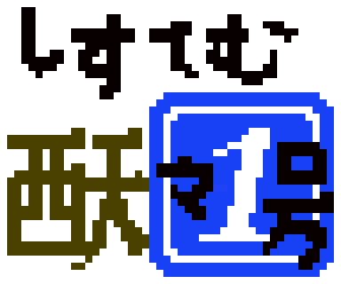

  <h1>Nisitenma-Ichigo / 西天満1号</h1>
  
  
(spelled しすてむ 西天マ1号 here)

## Overview

This repository provides a collection of tools for the **Nisitenma-Ichigo** game engine used by Konami Computer Entertainment Osaka (**KCEO**) and Konami Computer Entertainment Kobe (**KCEK**) on the Nintendo 64.
